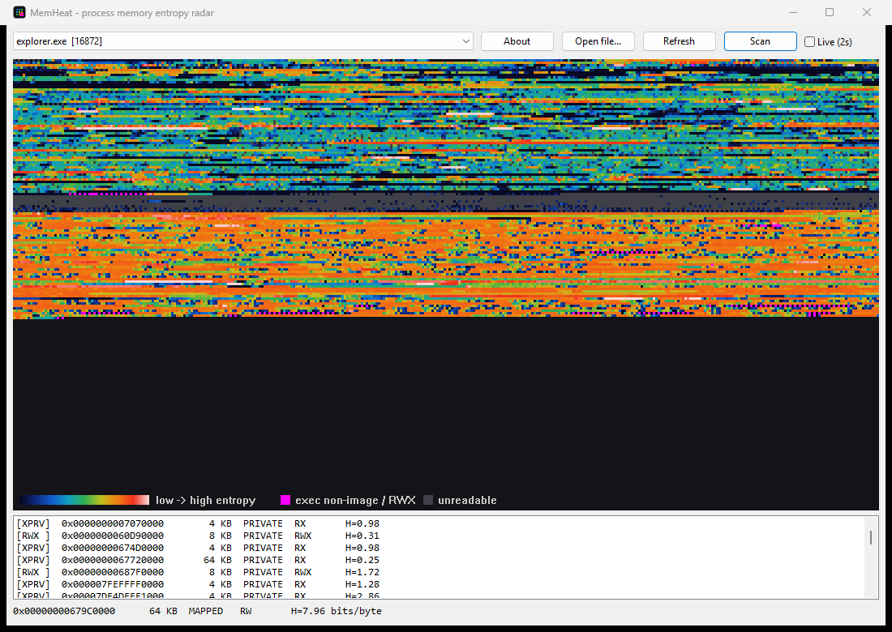
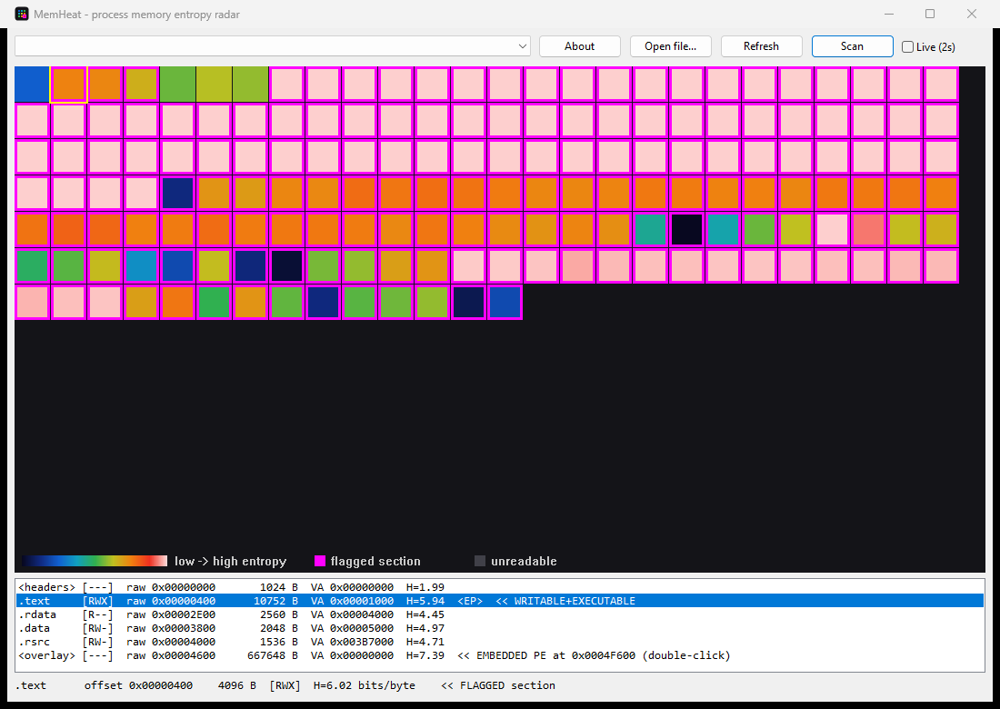
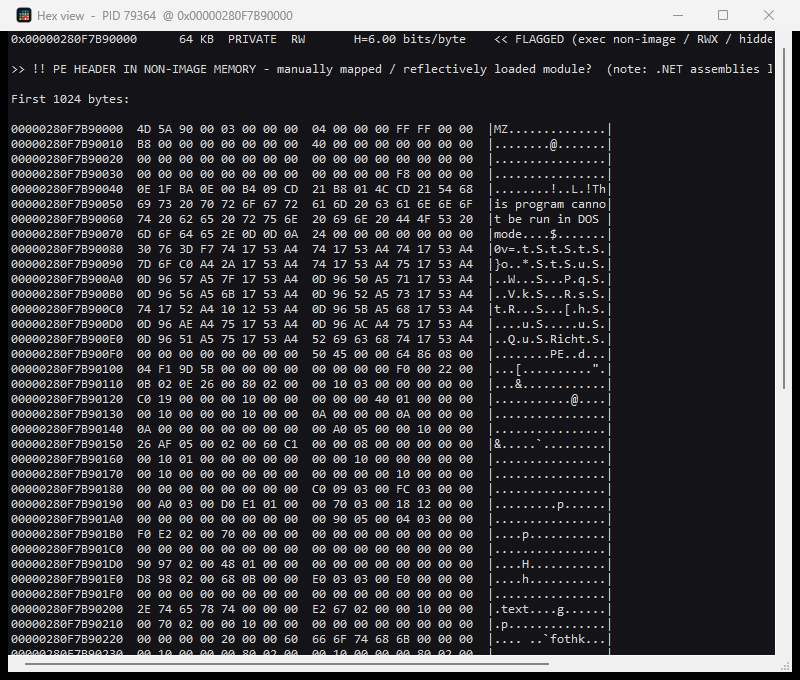

# MemHeat

**Process memory entropy radar for Windows, written in pure x86 assembly (MASM32).**

MemHeat maps the memory of a running process, or the contents of a PE file on disk, as an
entropy heatmap. It then flags what doesn't belong: injected shellcode, manually mapped
DLLs, packed code, writable-and-executable memory, and payloads hidden inside executables.

One 162 KB executable. No installer, no runtime, no dependencies.



---

## Why entropy?

Entropy measures how random a block of bytes is, on a scale from 0 to 8 bits per byte.

| Content | Typical entropy |
|---|---|
| Zeros / padding | 0 – 1 |
| Text, tables, structures | 3 – 5 |
| Normal machine code | 5.5 – 6.8 |
| **Compressed or encrypted data, packed code** | **7.2 – 8.0** |

Malware hides by encrypting or compressing itself, and it runs from memory that no file on
disk accounts for. Both leave a fingerprint. MemHeat combines entropy with memory type,
protection flags and PE-header checks, so those fingerprints show up as colored cells
you can point at.

---

## Features

### Memory mode: scan a running process
- **Full 64-bit coverage from a 32-bit binary** on any 64-bit Windows. MemHeat sees the
  entire address space of x64 processes, including memory above 4 GB that 32-bit tools
  can't reach. At startup MemHeat tests the WOW64 helper `NtWow64QueryVirtualMemory64`
  on itself and uses it if it works. If the helper is missing or broken (Windows 10 and
  11), MemHeat falls back to *Heaven's Gate*: it switches the CPU into 64-bit mode and
  calls the native 64-bit `NtQueryVirtualMemory` directly.
- **Entropy heatmap** of every committed memory region in 64 KB cells, colored from dark
  blue (low) to red/white (high). Unreadable memory is shown in gray.
- **Live mode** rescans every 2 seconds, so you can watch a process unpack or decrypt
  itself in real time.
- **Detections** (magenta-framed cells, listed under the map):

| Tag | What it means | Why it matters |
|---|---|---|
| `[XPRV]` | Executable **private** memory (not loaded from a file) | Classic shellcode or injected code location |
| `[XMAP]` | Executable **mapped** memory that isn't a loaded image | Code running from a mapped section |
| `[RWX ]` | Readable + writable + executable memory | Typical of shellcode loaders and unpackers |
| `[SHC!]` | **Shellcode patterns** in executable memory that no image file accounts for | Injected shellcode, C2 implants, loaders. Listed first |
| `[PE! ]` | **A PE header inside private memory** | Manually mapped / reflectively loaded DLL that Windows' loader never saw |

Each finding shows its address, size, type, protection, highest entropy, and a note when
the code looks packed or encrypted.

**Shellcode detection.** Executable memory that isn't backed by an image file is searched for
the tricks position-independent code needs to work:

| Indicator | Pattern |
|---|---|
| `PEB-walk` | `mov reg, fs:[30h]` (x86) / `mov reg, gs:[60h]` (x64): finding kernel32 without imports |
| `ROR13-hashing` | `ror reg, 13`: resolving APIs by hash instead of by name |
| `API-hash-constants` | Well-known ROR13 hashes of `LoadLibraryA`, `GetProcAddress`, `ExitProcess`, `KERNEL32.DLL` |
| `MSF/CS-stub` | The `cld; call` / `cld; and rsp,-16; call` prologue of Metasploit and Cobalt Strike payloads |
| `FPU-GetPC` | `fnstenv [esp-0Ch]` (shikata_ga_nai-style encoders) |
| `call/pop-GetPC` | `call $+5; pop reg`: finding its own address |
| `direct-syscall-stub` | `mov r10, rcx; mov eax, N`: syscalls made outside ntdll to dodge EDR hooks |

A region is flagged when it has one strong indicator (the first four), or two different weak
ones. Mapped views always need two different indicators, because they often hold genuine
precompiled code. Shellcode cells are drawn in **amber**. Double-clicking a `[SHC!]`
finding opens the hex view right at the first hit, with the indicators listed in the verdict.

### File mode: dissect a PE on disk
Open a file with **Open file...**, drag and drop it onto the window, or run
`MemHeat.exe <file>` (which also makes "Open with…" work).

- Splits the file into `<headers>`, every section, the `<overlay>`, and the
  Authenticode `<signatr>` (digital signature), each with its own entropy and
  read/write/execute flags.
- Marks the section that contains the **entry point** (`<EP>`).
- Works with both PE32 and PE32+ (x64). System32 paths open the real 64-bit files: WOW64
  redirection is turned off while reading.
- **Detections:**

| Note | Why it matters |
|---|---|
| `WRITABLE+EXECUTABLE` section | Compilers never produce this; packers and self-modifying code do |
| `packed/encrypted code?` | Executable section with entropy ≥ 7.2 |
| `high-entropy overlay` | Encrypted or compressed data appended to the executable |
| `EMBEDDED PE at 0x…` | A complete second executable hidden inside this one (dropper pattern) |
| `data appended AFTER the Authenticode signature` | Data hidden in a signed file without breaking its signature |

Signed Windows binaries are handled correctly: their signature block is identified and
**not** reported as a suspicious high-entropy overlay.



### Hex view
Double-click any cell or finding to see the first 1 KB as hex and ASCII, read live from
the process or from disk. The window opens with a verdict line, for example:

- `SHELLCODE INDICATORS: PEB-walk  MSF/CS-stub  ROR13-hashing`
- `PE HEADER IN NON-IMAGE MEMORY: manually mapped / reflectively loaded module?`
- `EMBEDDED PE FILE inside this file: dropper / packed payload?`
- `MZ signature without a valid PE header: damaged or deliberately wiped header?`
- `High entropy: compressed or encrypted data (or packed code)`
- `Executable bytes with normal entropy: plain machine code`

For embedded executables, it jumps straight to the embedded `MZ` header.



---

## Use cases

- **Malware triage.** Open a suspicious binary and see in seconds whether it's packed, has
  a payload appended, or carries a second executable inside.
- **Incident response.** Scan a running process for injected shellcode (with the hit located for you), RWX regions and
  manually mapped DLLs that won't appear in any module list.
- **Watching unpackers.** Turn on live mode and watch high-entropy regions turn into
  executable code as a packer decrypts itself.
- **Red team / EDR research.** Check what your own loader leaves behind in memory, and
  how visible a reflective DLL or shellcode runner really is.
- **Reverse engineering & CTFs.** Find the encrypted blob, the stub and the payload, then
  jump straight to the bytes.
- **Learning.** Shows memory layout, PE structure and entropy as pictures instead of
  numbers.

---

## Usage

| Action | How |
|---|---|
| Scan a process | Pick it from the list → **Scan** |
| Rescan continuously | Tick **Live (2s)** |
| Analyze a file | **Open file...**, drag & drop, or `MemHeat.exe C:\path\file.exe` |
| Inspect a block | Hover a cell for details, click to select, **double-click for hex view** |
| Jump to a finding | Click it in the list; double-click to open its hex view |

**Run as Administrator** to scan processes owned by other users and services
(`SeDebugPrivilege` is enabled automatically).

### Reading the heatmap
- **Dark blue → red/white**: low → high entropy
- **Amber frame**: shellcode indicators
- **Magenta frame**: other flagged memory (see the detection tables above)
- **Gray**: memory that couldn't be read (guard pages, no-access pages)

---

## Requirements

- Windows 10 or 11 (64-bit recommended; 32-bit Windows works with a 32-bit view)
- Nothing else. No .NET, no Visual C++ runtime, no installer.

---

## Limitations

- **Flagged ≠ malware.** It means "a human should look at this". Legitimate software can
  trigger detections: UPX-packed tools, installers with payloads in the overlay, JIT
  engines (browsers, .NET, Java) with RWX memory, and .NET assemblies loaded from byte
  arrays (which look like a `[PE! ]` hit).
- **Protected processes** (anti-malware services, some system processes) refuse to be
  opened, even as Administrator.
- The memory heatmap has 64 KB cells, so small regions are summarized at that size.
  Use the hex view for detail.
- File mode handles files up to 1 GB.

---

## Antivirus warnings

MemHeat uses techniques that malware also uses: Heaven's Gate mode switching,
reading other processes' memory, and enabling `SeDebugPrivilege`. Some antivirus products
may flag it for that reason. MemHeat only **reads** memory; it never writes to, injects
into, or modifies other processes or files.

Verify your download:

```
SHA-256  93B3BF9094AB2052537C3C6D5C0CDBC57F324A200FF449814542B0CE16121C26  MemHeat.exe
```

---

## Disclaimer

MemHeat is a read-only analysis tool for defensive security, research and education.
Use it only on systems and files you own or are authorized to analyze. It is provided
as-is, without warranty of any kind.
